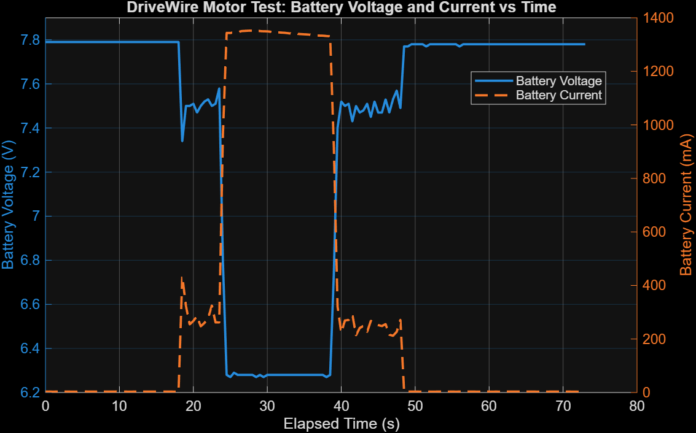
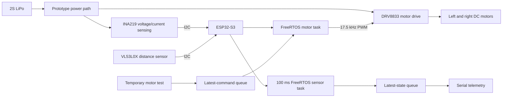
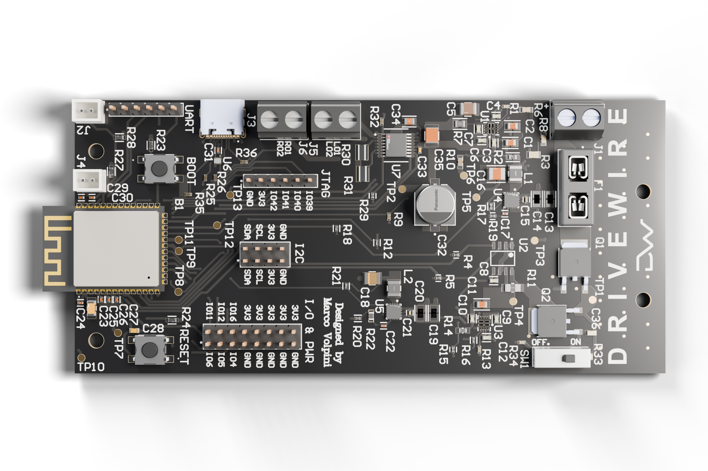

# DriveWire

### A hardware-tested ESP32-S3 rover for embedded control, vehicle telemetry, and power-electronics development

DriveWire is a scaled-down electric vehicle test platform built to take an embedded system from breadboard bring-up to a custom PCB running FreeRTOS software. The prototype supports two brushed DC motors and electrical and distance telemetry. The firmware now has separate FreeRTOS sensor and motor tasks, and the first custom PCB design and routing are complete in Altium.

> **Status - October 2026:** the breadboard prototype and core motor/sensor functions have been exercised on hardware. The custom PCB design is complete, pending final checks before fabrication. A dedicated motor task and temporary command test have been added. Telemetry currently runs over serial; Wi-Fi control and a browser dashboard are planned.

<p align="center">
  
</p>

## Engineering snapshot

| Area | Current implementation / evidence | In progress / next |
|---|---|---|
| Embedded firmware | Bidirectional motor control, braking/coasting, 17.5 kHz PWM, INA219 and VL53L0X drivers; dedicated motor task with command queue and 500 ms coast timeout | Motor-task hardware validation, control interface, system-level safety logic, encoder feedback |
| Real-time telemetry | 100 ms FreeRTOS sensor task, single-item queue, voltage/current/power/distance state, last-valid-data behavior on failed reads | Recovery after sensor power cycling, telemetry transport over Wi-Fi |
| Electrical | 2S LiPo bench testing and stall-current characterization; custom PCB schematic and routing complete, including 6 V and 3.3 V converters | Final design checks, fabrication, assembly, and board-level validation |
| Mechanical | Assembled 2WD chassis; three SolidWorks stand iterations; final stand printed in PLA and fit-tested | Dedicated sensor and battery mounting |

## Measured engineering evidence

- **Motor-current characterization:** two repeatable stall captures measured **1.3414 A** and **1.3308 A** using the onboard INA219. The firmware sampling period was reduced to 100 ms and the resulting trace was plotted in MATLAB to inform PCB current ratings.
- **Power-loss isolation:** during stall, INA219 telemetry fell to approximately **6.39 V**, but a DMM at the battery-connected rails measured only **7.78 V to 7.34 V**. This indicates that much of the observed drop is in the breadboard/prototype current path, which is now a design input for the PCB rather than an assumed battery failure.
- **PWM investigation:** a hardware sweep from 1 kHz to 18 kHz tied the audible motor tone to PWM carrier frequency. **17.5 kHz at 8-bit resolution** was selected and verified on both motors at full duty.
- **Sensor robustness:** communication errors mark the affected sensor offline while retaining its last valid telemetry. Invalid ToF ranges retain the previous distance while the sensor remains online. The VL53L0X produced reliable readings to approximately **1.3 m** under the tested indoor conditions.
- **Mechanical iteration:** the support stand progressed through three SolidWorks revisions before an approximately nine-hour PLA print; the finished part securely suspends the wheels for repeatable bench testing.

<p align="center">
  
</p>

## Current prototype architecture



The sensor and motor tasks each own a separate `DriveWireState` instance. The sensor task publishes telemetry through a one-element queue with `xQueueOverwrite()`. The motor task receives left/right PWM commands through its own one-element queue and coasts both motors after 500 ms without a new command. The current [`main.cpp`](Firmware/src/main.cpp) includes a temporary timed motor-command test while serial telemetry continues.

## Custom PCB

The first Altium PCB design combines a protected 2S LiPo power path, INA219 current sensing, TPS2121 motor-rail selection, 6 V and 3.3 V buck converters, motor drivers, and the ESP32 module. Interfaces include native USB programming with ESD protection, backup UART, JTAG, I2C expansion, and spare GPIOs.

Routing is complete, including compact buck input hot loops, thermal vias, and a stitched bottom-layer GND pour. The saved DRC report shows **zero active violations (19 waived)**. Final checks remain before fabrication; electrical and thermal performance will be validated during board bring-up. Design progress and images are recorded in the [build log](BuildLog.md#october-20).

<p align="center">
  
</p>

## Repository guide

| Path | Contents |
|---|---|
| [`Firmware/`](Firmware/) | PlatformIO project, motor control, sensor drivers, FreeRTOS tasks, and hardware test files |
| [`Hardware/`](Hardware/) | Altium project, power-design notes, datasheets, MATLAB test data, and plots |
| [`Mechanical/`](Mechanical/) | Chassis, battery wiring, and SolidWorks/3D-print documentation |
| [`BuildLog.md`](BuildLog.md) | Dated build history with test results, photos, and design decisions |
| [`Debugging.md`](Debugging.md) | Fault isolation, failed hypotheses, and resolved issues |
| [`BOM.md`](BOM.md) | Prototype bill of materials and status |

## Build the firmware

The firmware targets an **ESP32-S3-DevKitC-1** with Arduino through PlatformIO.

```bash
cd Firmware
pio run
pio device monitor -b 115200
```

The upload and monitor ports in [`Firmware/platformio.ini`](Firmware/platformio.ini) are workstation-specific and may need to be changed.

## Project scope

DriveWire is an active engineering project. The next hardware milestones are final design checks, fabrication, assembly, and validation of the protection and regulator stages. Firmware work will continue with motor-task hardware validation, wireless control, and closed-loop motion sensing.

---

<strong>Marco Volpini</strong><br>
Electrical Engineering, University of Waterloo
