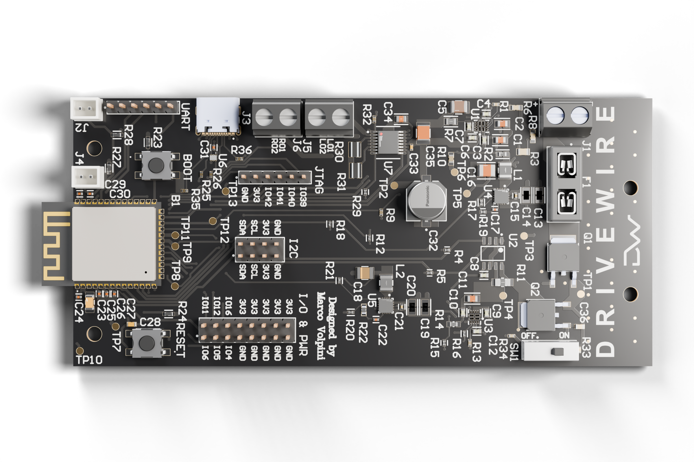
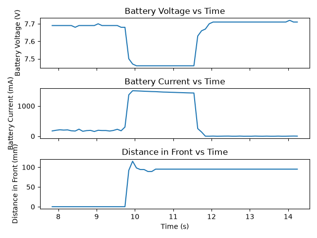
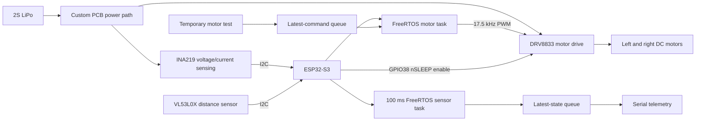
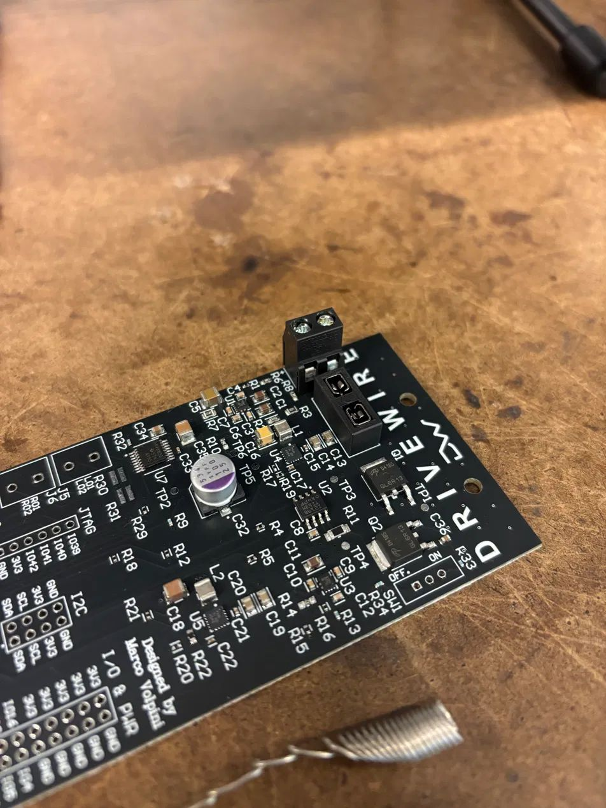

# DriveWire

### A hardware-tested ESP32-S3 rover for embedded control, vehicle telemetry, and power-electronics development

DriveWire is a scaled-down electric vehicle test platform built to take an embedded system from breadboard bring-up to a custom PCB running FreeRTOS software. The first fabricated board now runs both brushed DC motors through a dedicated motor task, reads onboard electrical telemetry and an external distance sensor, and streams measurements over USB-C into a Python plotting and logging tool.

> **Status - November 5, 2026:** custom PCB fabricated and in bench bring-up. Native USB firmware upload, INA219 telemetry, VL53L0X distance readings and motor-task operation have been demonstrated on the board. A corrected stall capture reached 1.503 A battery-side. Motor commands currently come from a timed test; custom command input, Wi-Fi control and a browser dashboard are next.

<p align="center">
  
</p>

<p align="center"><em>Altium render of the first custom PCB revision, now fabricated and undergoing bench testing.</em></p>

## Engineering snapshot

| Area | Current implementation / evidence | In progress / next |
|---|---|---|
| Embedded firmware | 17.5 kHz PWM; separate motor and sensor tasks; queued motor commands demonstrated on the custom PCB; 500 ms command timeout implemented | Custom PWM command input, system-level safety logic, encoder feedback |
| Real-time telemetry | Onboard INA219 and external VL53L0X readings on the custom PCB; 100 ms sensor task; USB serial plotting and CSV logging in Python | Reference-current comparison, recovery after sensor power cycling, Wi-Fi transport |
| Electrical | First PCB fabricated and assembled for bench testing; 3.31 V logic and 6.02 V buck-rail measurements; corrected battery-side stall capture | Further protection, supply-selection and thermal validation |
| Mechanical | Assembled 2WD chassis; three SolidWorks stand iterations; final stand printed in PLA and fit-tested | Dedicated sensor and battery mounting |

## Measured engineering evidence

- **Custom-PCB stall capture (November 5):** a 6 V motor-supply test recorded a **1.5025 A peak battery-side current** and a battery-voltage minimum of **7.46 V**, down from approximately **7.69 V** before the stall. Current is calculated from INA219 shunt voltage and the PCB's **20 mΩ** resistor, correcting the library default's 100 mΩ assumption. Reference-current comparison remains to be done; the capture does not measure individual motor currents or the 6 V rail under load.
- **Motor-driver bring-up:** serial traces confirmed that queued commands reached `drive()` while both motors remained stationary. Schematic tracing identified the missing DRV8833 `nSLEEP` initialization. Driving **GPIO38 high** after zeroing the PWM outputs, with a 2 ms wake delay, restored motor operation on the custom PCB.
- **Earlier breadboard characterization:** two stall captures measured **1.3414 A** and **1.3308 A** using the INA219 breakout. Sampling at 100 ms and plotting the trace in MATLAB informed the PCB current ratings.
- **Earlier power-loss isolation:** during breadboard stall testing, INA219 telemetry fell to approximately **6.39 V**, while a DMM at the battery-connected rails measured **7.78 V to 7.34 V**. The comparison identified losses in the prototype current path as a PCB design input.
- **PWM investigation:** a hardware sweep from 1 kHz to 18 kHz tied the audible motor tone to PWM carrier frequency. **17.5 kHz at 8-bit resolution** was selected and verified on both motors at full duty.
- **Sensor robustness:** communication errors mark the affected sensor offline while retaining its last valid telemetry. Invalid ToF ranges retain the previous distance while the sensor remains online. The VL53L0X produced reliable readings to approximately **1.3 m** under the tested indoor conditions.
- **Mechanical iteration:** the support stand progressed through three SolidWorks revisions before an approximately nine-hour PLA print; the finished part securely suspends the wheels for repeatable bench testing.

<p align="center">
  
</p>

[November 5 CSV capture](Firmware/6VStallRunCorrected.csv) · [Earlier breadboard stall plot](Images/StallCurrentPlot.png) · [November 5 build log](BuildLog.md#november-5) · [Debugging notes](Debugging.md#november-5)

## Current firmware architecture



The sensor and motor tasks each own a separate `DriveWireState` instance. The sensor task publishes telemetry through a one-element queue with `xQueueOverwrite()`. The motor task receives signed left/right PWM commands through its own one-element queue and coasts both motors after 500 ms without a new command. The current [`main.cpp`](Firmware/src/main.cpp) includes a temporary timed motor-command test while serial telemetry continues. The [`Python tool`](Firmware/tools/telemetry.py) reads voltage, current and distance, saves a CSV and plots the readings live. Custom serial and network command handlers are planned to feed the same motor queue.

## Custom PCB

The first Altium PCB combines a fused 2S LiPo power path with reverse-polarity protection and a MOSFET-controlled switch, INA219 current sensing, TPS2121 supply selection, 6 V and 3.3 V buck converters, a DRV8833 dual motor driver, and an ESP32-S3 module. Interfaces include native USB programming with ESD protection, backup UART, JTAG, I2C expansion, and spare GPIOs.

The board was sent for fabrication on October 23 and received on October 31. Layout work included compact buck input hot loops, thermal vias, and a stitched bottom-layer GND pour; the pre-fabrication DRC result recorded **zero active violations (19 waived)**. Assembly and bring-up have since established USB programming, sensor telemetry and motor operation. Rail spot checks measured **3.31 V** on the logic supply and **6.02 V** on the 6 V buck output. Further protection, supply-selection and thermal testing remains. See the [layout entry](BuildLog.md#october-20) and [latest bench results](BuildLog.md#november-5).

<p align="center">
  
</p>

## Repository guide

| Path | Contents |
|---|---|
| [`Firmware/`](Firmware/) | PlatformIO project, motor control, sensor drivers, FreeRTOS tasks, and hardware test files |
| [`Hardware/`](Hardware/) | Altium project, power-design notes, datasheets, MATLAB test data, and plots |
| [`Mechanical/`](Mechanical/) | Chassis, battery wiring, and SolidWorks/3D-print documentation |
| [`BuildLog.md`](BuildLog.md) | Dated build history with test results, photos, and design decisions |
| [`Debugging.md`](Debugging.md) | Fault isolation, failed hypotheses, and resolved issues |
| [`BOM.md`](BOM.md) | Prototype bill of materials and status |

## Build the firmware

The firmware uses PlatformIO's **ESP32-S3-DevKitC-1** board definition with Arduino and now runs on the custom ESP32-S3 PCB with native USB CDC enabled.

```bash
cd Firmware
pio run
pio device monitor -b 115200
```

The upload and monitor ports in [`Firmware/platformio.ini`](Firmware/platformio.ini) are workstation-specific and may need to be changed.

## Project scope

DriveWire is an active engineering project. The next steps are custom PWM command input, Wi-Fi control and a browser dashboard, followed by closed-loop motion sensing. Hardware work continues with reference-current comparison and further validation of the protection, supply-selection and thermal behavior.

---

<strong>Marco Volpini</strong><br>
Electrical Engineering, University of Waterloo
